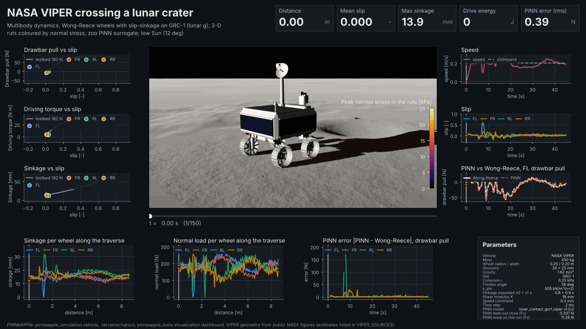
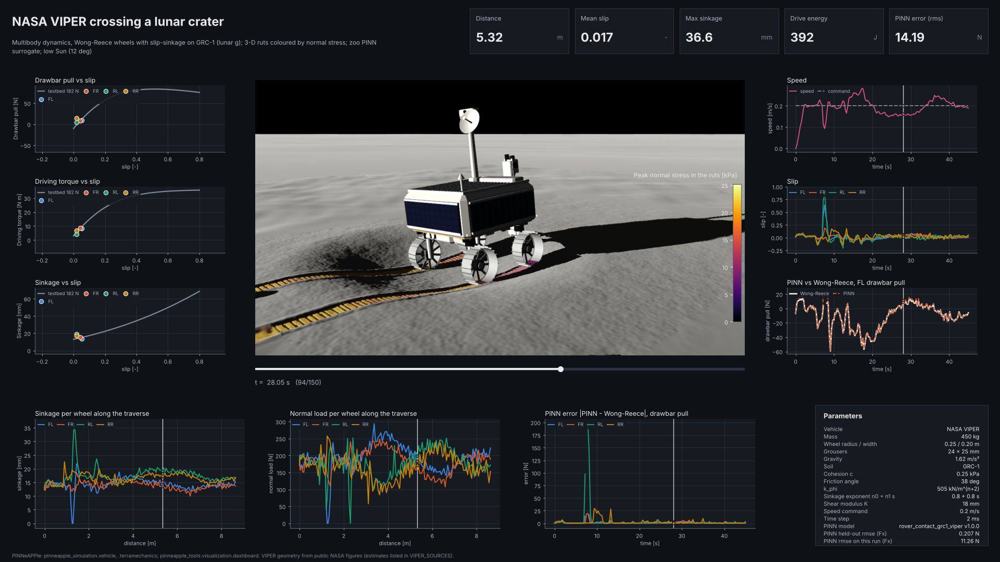
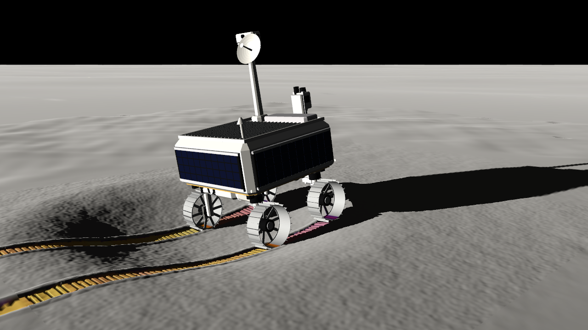

# Animation-centred dashboards

[](https://colab.research.google.com/github/PINNeAPPle-Labs/PINNeAPPle/blob/main/notebooks/colab/04_lunar_rover_dashboard.ipynb)

`pinneapple_tools.visualization.dashboard` turns any time-dependent simulation into one view:
- the animation in the middle;
- charts around it, synchronised to its time cursor;
- KPI tiles across the top;
- a parameter panel and a colour bar.

The same dashboard exports as:
- an **interactive HTML page** (one self-contained file, no server and no internet; scrubbing a chart moves the
  animation);
- a **static PNG**;
- a **GIF/MP4** of the dashboard playing.

It uses the dark style of the studio renders (aircraft, Formula car).



Interactive page: [rover-dashboard.html](../assets/studio/rover-dashboard.html) (≈ 6.3 MB, opens offline).
Static: [rover-dashboard.png](../assets/studio/rover-dashboard.png). Video: [rover-dashboard.mp4](../assets/studio/rover-dashboard.mp4).

```python
from pinneapple_tools.visualization.dashboard import Dashboard, Chart, Series, Marker, Tile, Param, ColorBar

db = Dashboard("Damped pendulum", t, frames,                 # frames: RGB arrays or image paths, one per t [s]
    charts=[Chart("Angle", "angle [rad]", "time [s]", [Series("theta", theta)], slot="left"),
            Chart("Phase portrait", "rate [rad/s]", "angle [rad]", [Series("orbit", rate, x=theta)],
                  [Marker("now", theta, rate)], kind="phase", slot="right"),
            Chart("Energy", "E [J/kg]", "time [s]", [Series("E", E)], slot="bottom")],
    tiles=[Tile("Energy", E, "J/kg")], params=[Param("Length", 1.0, "m")],
    colorbar=ColorBar("Speed [m/s]", "inferno", 0, 3))
db.to_html("pendulum.html")                                  # interactive, self-contained
db.to_png("pendulum.png", k=40)                              # the dashboard at frame 40
db.to_video(gif="pendulum.gif", mp4="pendulum.mp4", fps=12)  # GIF downscaled with gif_size / gif_every
```

## Parts

| Part | What it is |
|---|---|
| `Dashboard(title, t, frames, ...)` | the frames of the animation and their times; `subtitle`, `footer`, `colorbar` |
| `Chart(title, ylabel, xlabel, series, markers, kind, slot)` | `slot`: `"left"`, `"right"` or `"bottom"`. Units go in the labels |
| `kind="series"` | one value per frame (`x` defaults to the times; any per-frame axis such as distance works). A cursor line follows the animation, and clicking or dragging the chart moves it |
| `kind="phase"` | fixed curves (`Series(..., x=...)`) plus `Marker`s that move with the frames, e.g. a testbed curve and the operating point of each wheel |
| `Tile(label, value, unit, fmt)` | a KPI, either a scalar or one value per frame (the tile follows the cursor) |
| `Param(label, value, unit)` | a line of the parameter panel |
| `ColorBar(title, cmap, lo, hi)` | the colour scale of the field shown in the animation |
| `Dashboard.scene3d` | optional live three.js view (below) |

Colour follows the entity: a label gets the same colour on every chart, taken in a fixed order from the categorical
palette's dark-surface steps. The four-slot set was checked for colour-vision deficiency and contrast against the
panel colour. A missing value (NaN) leaves a gap in a line.

## The interactive page

`to_html(path)` writes one file.

**Animation.** It is embedded as VP9 WebM plus H.264 MP4 sources with a keyframe every 4 frames, so seeking is
exact and every browser engine finds a format it plays. Without ffmpeg it falls back to JPEG frames.

**Charts:**
- drawn on canvases at the screen's pixel density;
- hovering shows a crosshair and the values;
- clicking or dragging a time chart moves the animation to that instant;
- play/pause, a speed selector, a time slider and the arrow keys step through the frames;
- the tiles follow the cursor.

**Reuse of the studio viewer.** The colour bar and the number formatting come from the studio viewer's
`studio-core.js`, inlined, so they match the viewer and the renders.

**Live 3D.** With `scene3d` set, a *Live 3D* tab draws the vehicle parts moving with the frames over the terrain.
It uses the studio's vendored three.js, inlined through an import map, and a `studio.lighting` preset (black lunar
sky, low Sun). The view orbits freely and follows the scrubbed time. `html.scene3d_payload(bodies, poses, terrain,
lighting)` builds the data for any rigid-body animation.

Size depends on the frames. The rover page, with 150 frames at 1024 px plus the 3D data, is 6.1 MB.

## Static PNG and videos

`to_png` and `to_video` draw the same layout with matplotlib (1920 × 1080 by default). The figure is drawn once;
each frame only changes the image, the cursors, the moving markers and the tiles. The MP4 keeps every frame. The
GIF is downscaled (`gif_size`) and can skip frames (`gif_every`) at the same playback speed; its 256-colour palette
shifts the series colours a little, so the MP4 and the HTML page are the reference versions.

## The rover dashboard

`pinneapple_simulation.vehicle.dashboard` builds the dashboard of any vehicle run:

```python
import pinneapple as pp
from pinneapple_simulation.vehicle import dashboard as vdash
frames, ks, clim = vdash.render_frames(run, terrain, n=150,      # planetary renders, 3-D ruts
                                       field="normal_stress", field_alpha=0.6, field_glow=0.1)
db = vdash.vehicle_dashboard(run, frames, ks, model=wong_reece, surrogate=pp.zoo.load("rover_contact_grc1_viper"),
                             clim=clim, field_label="Peak normal stress in the ruts [kPa]",
                             scene3d=True, terrain=terrain)
```

The animation shows:
- a hard, low Sun (`lunar_low_sun`, 12°) under a black sky, with long shadows;
- regolith with small craters and rocks;
- wheels that roll with the joint angles and leave ruts deformed into the terrain mesh: a floor at the computed
  sinkage, walls at the angle of repose, berms of displaced soil and grouser marks spaced by the pitch and the
  slip, all shaded and shadowed by the low Sun;
- the ruts coloured by the peak normal stress they carried [kPa], with its colour bar. The map is semi-transparent
  (`field_alpha=0.6`, `field_glow=0.1`): it tints the regolith's albedo before the photometry, so the rut walls,
  the grouser marks and the Sun's shading and shadows stay visible through it;
- the ground running out to the real lunar horizon, so no mesh edge shows in any frame (checked for the frames by
  `studio.planetary.border_visibility`).

Around it:
- **left:** drawbar pull, driving torque and sinkage versus slip. The grey line is the single-wheel testbed curve at
  the static wheel load; the dots are the four wheels' live operating points;
- **right:** speed against the command; slip per wheel; the PINN against the run's Wong-Reece model for the
  front-left wheel (same inputs; gaps where a wheel leaves the PINN's training box). The PINN is the pre-trained
  model of the model zoo, `pp.zoo.load("rover_contact_grc1_viper")`; a zoo model is wrapped in
  `terramechanics.surrogate.ZooContactSurrogate`;
- **bottom:** sinkage and normal load per wheel along the traverse; the PINN's error for every wheel;
- **tiles:** distance [m], mean slip, maximum sinkage [mm], drive energy [J] and the PINN's RMS error [N], all up
  to the cursor;
- **parameters:** the vehicle, the wheel, the soil (with units), gravity, the command, the time step, the PINN
  model, its held-out error (from its model card) and its error along this run.



`examples/studio/07_lunar_rover_dashboard.py` regenerates every file:
- `docs/assets/studio/rover-dashboard.{html,png,gif,mp4}`: the MP4 at 1920 × 1080; the GIF at 1280 × 720, laid
  out natively at that size (`to_video(gif_font_scale=1.0)`) so the chart text stays readable, with one shared
  octree palette and frame differencing to stay under 6 MB (`dashboard.static.write_gif`);
- `rover-frame.png`, one rendered frame.

The run behind it is the crater crossing of the [lunar rover page](lunar_rover_terramechanics.md): NASA VIPER
(450 kg) on GRC-1 at lunar gravity, a 0.2 m/s command, 45 s, 2 ms steps. The rover covers 8.63 m with a mean slip of
0.018 and a maximum sinkage of 36.6 mm (the rear-left wheel digging in while it pushes against the rock), uses
794 J (92 J/m), and reaches 10.5° of pitch and 3.8° of roll; the front-left wheel leaves the soil for a moment near
1.3 m (its sinkage and load drop to zero).

**The zoo PINN along the run.** Its model card gives a held-out drawbar-pull RMSE of 0.207 N against its own
reference. Along this run, against the run's Wong-Reece model, the drawbar-pull RMSE over all wheels is 11.3 N.
Almost all of it comes from a few samples near the rock, where the rear-left wheel slips up to ≈ 0.8 and the error
reaches ≈ 190 N; elsewhere it is a few newtons. The reason is the model, not the network: the zoo model was trained
on GRC-1 before slip-sinkage was added to the library (n1 = 0), while the run uses n1 = 0.8 (see the
[lunar rover page](lunar_rover_terramechanics.md)). Against the n1 = 0 Wong-Reece model it was trained on, its
drawbar-pull RMSE at the states of this run is 0.35 N. Retraining the zoo model on the current GRC-1
(`scripts/zoo/train_rover_contact.py`) and publishing it would bring the run error back to that level.


