# Geometry library

Realistic parametric 3-D geometries for Physics-AI, each with the code that regenerates it and ready-made files
you can just import. Every entry is in **metres** in a documented frame, made of **closed, outward-oriented
bodies** (watertight, no self-intersections, checked by `tests/test_geometry_library.py`), at two levels of detail:
`light` (committed in `data/geometries/`, at most a few tens of thousands of triangles) and `fine` (on the Hugging
Face Hub, dataset [`PINNeAPPle-Labs/geometry-library`](https://huggingface.co/datasets/PINNeAPPle-Labs/geometry-library)).
Real-world dimensions come from the published sources listed by `info()`; values chosen by engineering judgement
are flagged as estimates.

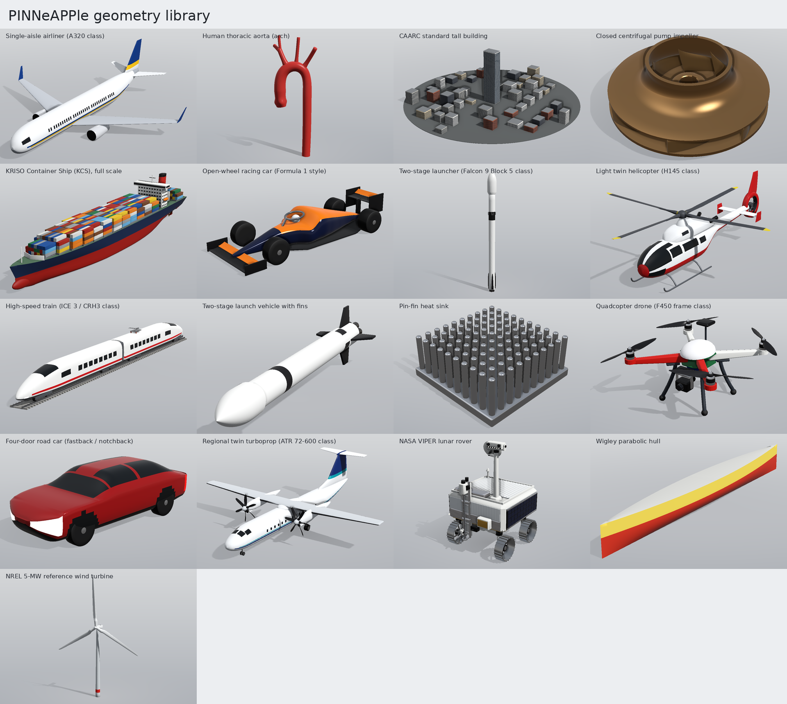

```python
import pinneapple as pp

pp.geometries.list()                                  # names (also pp.geometries.categories())
pp.geometries.info("wind_turbine_nrel5mw")            # dimensions, parameters with ranges, sources, physics uses
g = pp.geometries.build("wind_turbine_nrel5mw", pitch_deg=8.0, rotor_azimuth_deg=30.0)
g.check()                                             # watertight / outward per body, bounding box
g.export("turbine.stl"); g.export("turbine.glb"); g.export("turbine.step"); g.export("turbine.usda")
g.solid()                                             # one fused watertight surface for meshing (manifold3d)
g.scene()                                             # pinneapple_tools.visualization.studio Scene: Blender, web viewer
g.render("turbine.png")                               # thumbnail (software renderer, no GPU)
pp.geometries.load("airliner_a320", format="glb")     # path of the pre-generated file
pp.geometries.load("airliner_a320", format="stl", lod="fine")   # downloaded from the Hub, SHA-256 checked, cached
```

## Files and the loader

| level | triangles | where | formats |
|---|---|---|---|
| `light` | <= 20 000 (36 000 for the airliner and the two-stage launcher) | repository (`data/geometries/<name>/`) and Hub | STL, glTF (in git); OBJ, USD, STEP (Hub) |
| `fine` | up to 400 000 | Hub | STL, glTF, OBJ, USD |

`load(name, format, lod)` looks in the repository copy, then the cache (`~/.cache/pinneapple/geometries`,
`$PINNEAPPLE_GEOMETRY_CACHE`), then the Hub, verifies the SHA-256 recorded in
`pinneapple_design/geometry_library/manifest.json`, and falls back to `build()` with the default parameters when
offline (`PINNEAPPLE_OFFLINE=1`) or when the file is not published yet. The defaults reproduce the stored files
(the test compares the rebuilt light STL with the committed one). STEP is a faceted B-rep (one solid per body, planar
triangular faces) that OpenCASCADE, FreeCAD and the usual CAD tools import as solids; it is published for the light
level (the fine one would be about 100 MB, export it locally with `g.export("x.step")` if needed).

The `geometries` job of `.github/workflows/publish-zoo.yml` rebuilds every file, checks it against the manifest and
uploads it to the Hub when the repository secret `HF_TOKEN` is set (it skips the upload with a warning otherwise), then
verifies the published files by anonymous download.
Regenerate after changing an entry:

```bash
python scripts/geometry_library.py light       # light STL + glTF, thumbnails
python scripts/geometry_library.py hub         # all files of both levels in dist/geometries
python scripts/geometry_library.py manifest    # SHA-256 of everything
python scripts/geometry_library.py sheet       # contact sheet + turntable GIF
python scripts/geometry_library.py docs        # this page
```

## Reference frames

Vehicles: right-handed, x aft from the nose (the free-stream direction), y to starboard, z up, z = 0 on the ground for
ground vehicles. Other entries state their own frame in `info(name)["frame"]` (e.g. the wind turbine: x downwind, z up
from the tower base; the aorta: patient axes). Every geometry is in metres, including the heat sink and the aorta.

## Examples

- `examples/geometry_library/01_caarc_building_wind_openfoam.py`: the CAARC tall building in an atmospheric
  boundary layer with OpenFOAM through the generic STL path of `pp.cfd.ExternalFlow` (writes the case when
  OpenFOAM is not installed).
- `examples/geometry_library/02_wind_turbine_bem.py`: blade-element momentum on the NREL 5-MW blade of the library:
  power and thrust curve, compared with the published rated power.
- `examples/geometry_library/03_airliner_vlm.py`: vortex-lattice lift slope, neutral point and induced drag of the
  airliner, plus a wetted-area friction-drag estimate from the library mesh.

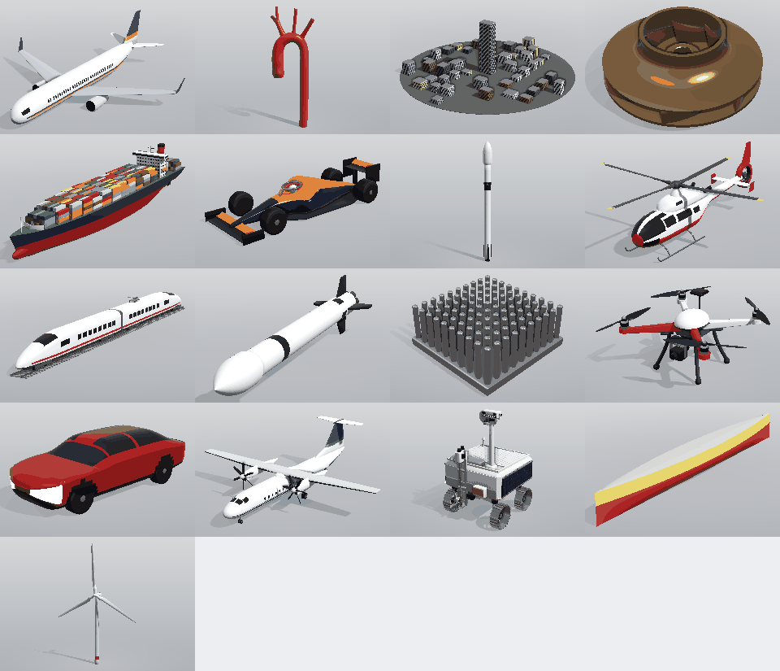

## Gallery


### Aircraft

#### Single-aisle airliner (A320 class) (`airliner_a320`)

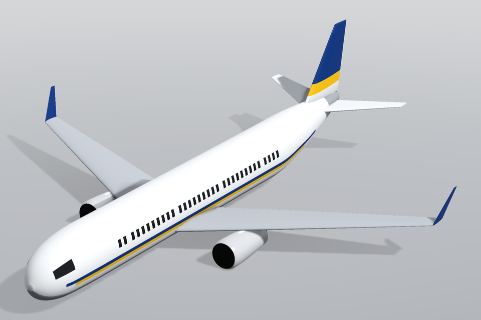

Circular fuselage with cabin and cockpit windows and a livery, low swept wing with dihedral, washout and sharklets, two under-wing turbofans on pylons, swept tails sized by volume coefficient; in cruise (gear up). Wraps pinneapple_design.aero.airliner.Airliner.

- Bounding box (default build, L x W x H): 38.75 x 35.43 x 10.23 m. Frame: right-handed, metres: x aft from the nose (the free-stream direction), y to starboard (right), z up; origin on the centre plane at the nose, z = 0 on the fuselage axis.
- Parameters: `length` [m], `wing_area` [m^2], `aspect_ratio`, `taper`, `sweep_le` [deg], `dihedral` [deg], `twist` [deg], `fan_diameter` [m], `engine_station`, `sharklets`.
- Physics: external aerodynamics (RANS, cruise lift/drag, high-lift studies); vortex-lattice / panel methods; wake-vortex and contrail studies; aero-structural wing optimisation.
- Sources: length 37.57 m, span 35.80 m with sharklets (34.10 m without), fuselage width 3.95 m, wing area 122.6 m^2, height 11.76 m on the gear: Airbus (2023). A320 Aircraft Characteristics - Airport and Maintenance Planning, Rev. 41, section 2-2 (general dimensions). https://aircraft.airbus.com/en/customer-care/fleet-wide-care/airport-operations-and-technical-data/aircraft-characteristics; *(estimate)* LE sweep, dihedral, washout, tail volume coefficients, airfoil (NACA 2412 stand-in for the supercritical section): engineering estimates from public three-views; *(estimate)* bounding box of the model: 38.75 m long (the swept horizontal-tail tips end 1.2 m behind the 37.57 m tail cone), 35.43 m span over the sharklets, 10.2 m high in cruise with the gear retracted (11.76 m on the gear): model geometry
- Wraps `pinneapple_design.aero.airliner.Airliner` (still importable from there).
- Known: wing_right: sub-millimetre crossings of the sharp trailing edge (legacy loft); wing_left: sub-millimetre crossings of the sharp trailing edge (legacy loft); sharklet_r: sub-millimetre crossings of the sharp trailing edge (legacy loft); sharklet_l: sub-millimetre crossings of the sharp trailing edge (legacy loft).

#### Quadcopter drone (F450 frame class) (`quadrotor_drone`)

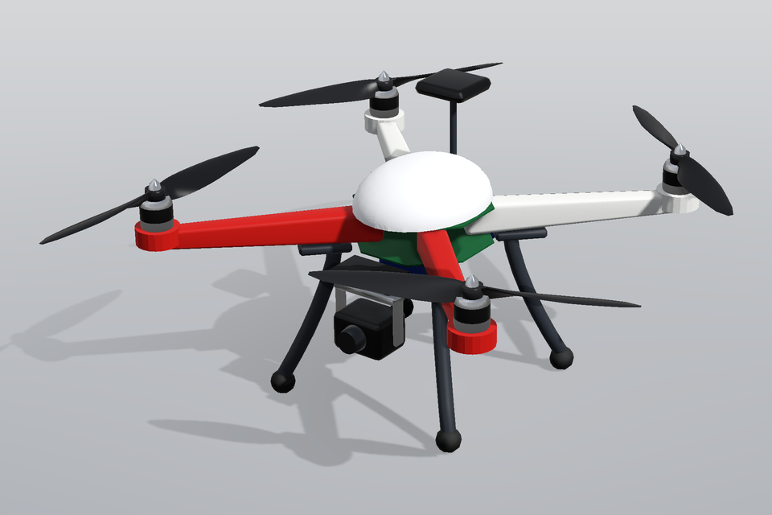

X-configuration quadcopter on its landing legs: 450 mm diagonal frame with PCB centre plates, red front / white rear arms, 2212-class outrunner motors, four counter-rotating two-blade 10 x 4.5 in propellers (constant geometric pitch, cambered sections, swept tips), canopy, GPS mast, battery and a two-axis camera gimbal.

- Bounding box (default build, L x W x H): 0.559 x 0.498 x 0.27 m. Frame: right-handed, metres: x aft (the nose is between the two red arms, at -x), y to starboard, z up; origin on the ground below the frame centre (feet on z = 0).
- Parameters: `arm_diagonal` [m], `prop_diameter` [m], `prop_pitch` [m], `rotor_azimuth_deg` [deg].
- Physics: multirotor aerodynamics (rotor-rotor and rotor-frame interaction, hover / forward flight); propeller noise; ground effect and downwash; flight-dynamics / control surrogates.
- Sources: 450 mm diagonal wheelbase, 10 x 4.5 in propellers, 2212-class motors: DJI (2013). Flame Wheel F450 user manual / specifications: diagonal wheelbase 450 mm, frame weight 282 g, recommended 10 x 4.5 in propellers and 2212 motors. https://www.dji.com/flame-wheel-arf; constant geometric pitch: blade angle atan(P / (2 pi r)): standard propeller nomenclature (e.g. McCormick, B.W. (1995). Aerodynamics, Aeronautics and Flight Mechanics, 2nd ed., Wiley); *(estimate)* plate size, arm section, motor 28 x 26 mm, blade chord / thickness distribution, landing legs, 3S battery 135 x 43 x 26 mm, gimbal and camera sizes: estimates from hobby-grade parts

#### Regional twin turboprop (ATR 72-600 class) (`turboprop_atr72`)

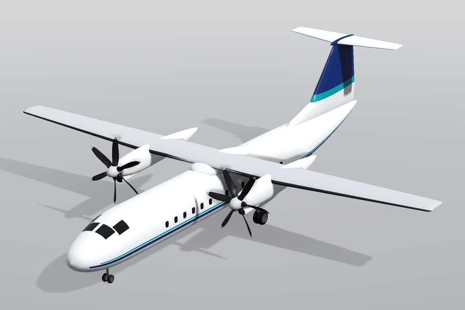

High-wing regional twin turboprop on its gear: fuselage with cabin windows, cockpit glazing and a livery, untapered inner / tapered outer wing with a morphing plain flap and leading-edge de-icing boots, two nacelles with chin intakes and spinners, six-blade propellers lofted with constant geometric pitch, T-tail with dorsal fin, main-gear sponsons with twin wheels and a twin nose wheel.

- Bounding box (default build, L x W x H): 27.17 x 27.05 x 7.65 m. Frame: right-handed, metres: x aft from the nose (the free-stream direction), y to starboard (right), z up; origin on the centre plane at the nose, z = 0 on the ground (aircraft on its gear, tyres touching z = 0).
- Parameters: `wing_span` [m], `wing_area` [m^2], `flap_deg` [deg], `prop_diameter` [m], `blade_pitch_deg` [deg], `prop_azimuth_deg` [deg], `htail_span` [m].
- Physics: external aerodynamics of a high-wing turboprop (RANS, take-off / landing flap settings); propeller-wing interaction and slipstream (actuator disc / sliding-mesh blades); propeller aero-acoustics and cabin noise sources; icing on the wing and tail leading edges; ground effect and crosswind on the gear.
- Sources: overall length 27.17 m, span 27.05 m, height 7.65 m, wing area 61.0 m^2, wheel track 4.10 m, wheelbase 10.77 m, six-blade propellers of 3.93 m: ATR (2014). ATR 72-600 Aircraft Characteristics for Airport Planning (ATR 72 AC/AP), section 2 general dimensions; and ATR, 'ATR 72-600' product data sheet. https://www.atr-aircraft.com/our-aircraft/atr-72-600/; propeller diameter 3.93 m, six composite blades: Collins Aerospace (Hamilton Sundstrand) 568F six-blade composite propeller, diameter 3.93 m, as fitted to the ATR 72-600 (EASA Type-Certificate Data Sheet P.009 for 568F propellers; ATR 72 TCDS EASA.A.084); *(estimate)* fuselage maximum width 2.77 m and height 2.62 m (published external diameter quoted 2.77-2.87 m; 2.77 m used): estimate from ATR 72 airport-planning cross-section; *(estimate)* wing planform: constant chord to 4.6 m, taper 0.55 outboard, 3.1 deg LE sweep, 2 deg outer dihedral, NACA 3418 -> 3413 stand-ins for the ATR sections, 1 deg -> -2 deg twist: engineering estimates from public three-views; *(estimate)* nacelle, sponson, fin / dorsal fillet, tailplane chords, blade chord / thickness / sweep, main tyre 0.82 m and nose tyre 0.45 m diameters, gear position: estimates from photographs and three-views; *(estimate)* tailplane span 7.31 m: ATR 72 three-view dimension (published in Jane's All the World's Aircraft; treated as approximate)


### Biomedical

#### Human thoracic aorta (arch) (`aortic_arch`)

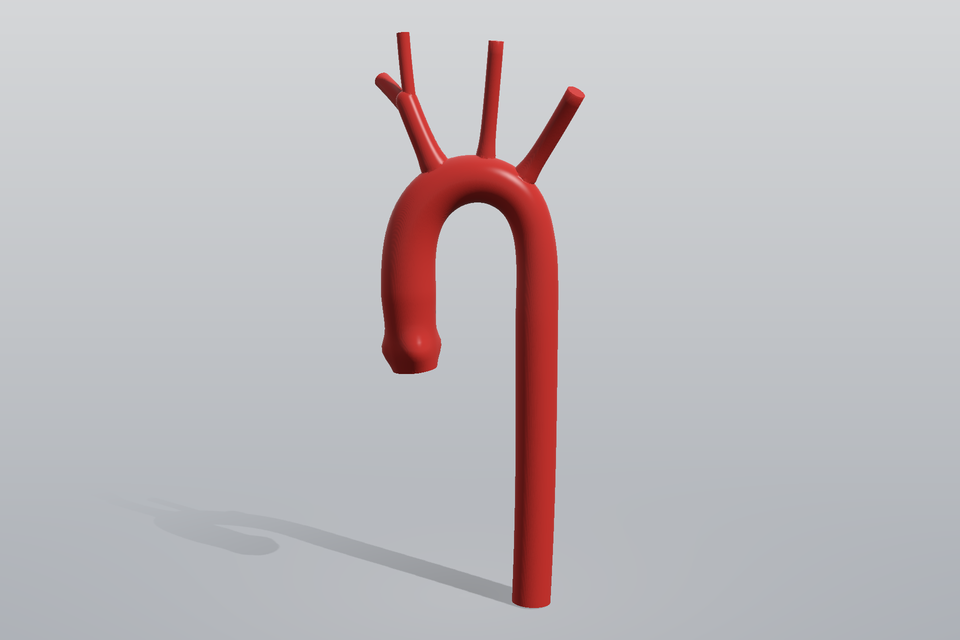

Adult human thoracic aorta lumen: aortic root with three-lobed sinus of Valsalva, ascending aorta, arch and descending thoracic aorta with the brachiocephalic trunk, left common carotid and left subclavian arteries, fused (manifold3d union) into one watertight lumen with flat-capped inlet and outlets.

- Bounding box (default build, L x W x H): 0.1134 x 0.0766 x 0.3114 m. Frame: right-handed patient frame, metres: x towards the patient's left, y posterior, z cranial; origin at the centre of the aortic-root inlet (annulus plane).
- Parameters: `ascending_diameter` [m], `sinus_diameter` [m], `arch_diameter` [m], `descending_diameter` [m], `arch_radius` [m], `ascending_length` [m], `descending_length` [m], `arch_plane_deg` [deg], `bct_diameter` [m], `lcca_diameter` [m], `lsa_diameter` [m], `bct_angle_deg` [deg], `lcca_angle_deg` [deg], `lsa_angle_deg` [deg], `bct_bifurcation`, `rsa_diameter` [m], `rcca_diameter` [m], `fused`.
- Physics: hemodynamics: pulsatile blood flow, wall shear stress, secondary flow in the arch; aneurysm / coarctation and stent-graft planning studies; fluid-structure interaction of the aortic wall; particle (embolus) transport into the supra-aortic branches.
- Sources: thoracic aortic diameters by segment (sinus ~33-36 mm, ascending ~29-32 mm, arch ~26-28 mm, descending ~23-26 mm in adults): Hager, A., Kaemmerer, H., Rapp-Bernhardt, U., Bluecher, S., Rapp, K., Bernhardt, T.M., Galanski, M., Hess, J. (2002). Diameters of the thoracic aorta throughout life as measured with helical computed tomography. J. Thorac. Cardiovasc. Surg. 123(6), 1060-1066. https://doi.org/10.1067/mtc.2002.122310; arch geometry (arch width / height, curvature radius ~30-35 mm): Redheuil, A., Yu, W.C., Mousseaux, E., et al. (2011). Age-related changes in aortic arch geometry: relationship with proximal aortic function and left ventricular mass and remodeling. J. Am. Coll. Cardiol. 58(12), 1262-1270. https://doi.org/10.1016/j.jacc.2011.06.012; *(estimate)* chosen defaults within the published ranges, branch diameters 12 / 8 / 10 mm, branch take-off angles, lengths, sinus lobing, arch plane rotation and the centreline shape: anatomical estimate


### Civil

#### CAARC standard tall building (`caarc_building`)

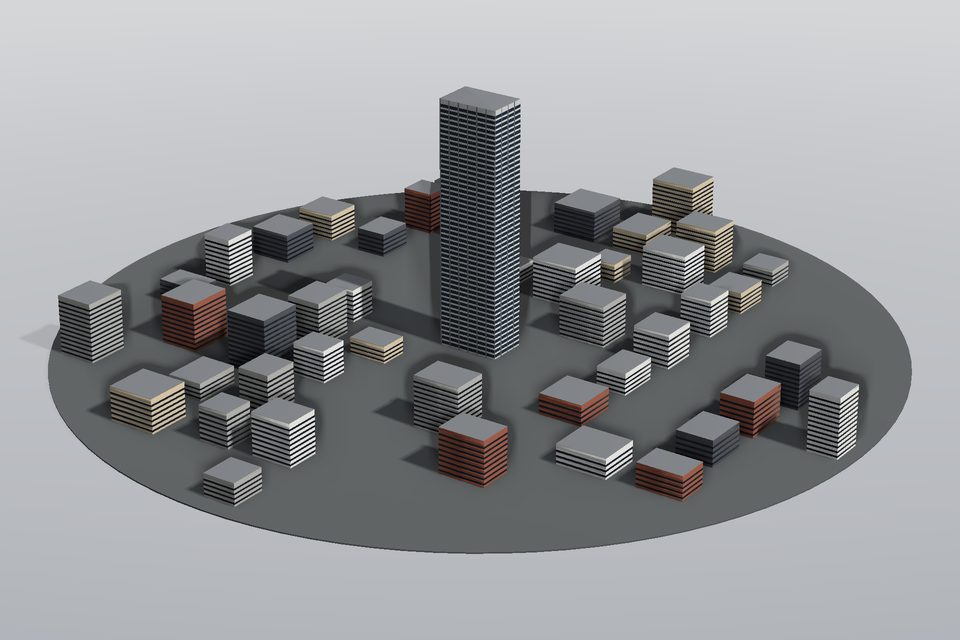

The CAARC standard tall building for wind-loading comparisons: a 30.48 x 45.72 x 182.88 m (100 x 150 x 600 ft) prism with a 50-storey curtain-wall facade, in a deterministic urban block of lower buildings on a 300 m-radius turntable ground (top at z = 0).

- Bounding box (default build, L x W x H): 600 x 600 x 183.9 m. Frame: right-handed, metres, full scale: x the wind direction at 0 deg incidence (normal to the 45.72 m wide face), y across, z up; origin at the tower base centre on the ground (z = 0 is the ground top; the ground disc is 1 m thick).
- Parameters: `height` [m], `width` [m], `depth` [m], `orientation_deg` [deg], `surroundings`, `density`, `seed`, `ground_radius` [m].
- Physics: mean and fluctuating wind pressures on a tall building (CAARC benchmark); along / across-wind base moments and vortex shedding; LES of the atmospheric boundary layer with urban roughness; pedestrian-level wind comfort around the tower.
- Sources: 100 x 150 x 600 ft (30.48 x 45.72 x 182.88 m) CAARC tall-building model, wind normal to the wide face at 0 deg: Melbourne, W.H. (1980). Comparison of measurements on the CAARC standard tall building model in simulated model wind flows. J. Wind Eng. Ind. Aerodyn. 6(1-2), 73-88. https://doi.org/10.1016/0167-6105(80)90023-9; *(estimate)* 50 storeys of 12 ft, curtain-wall bays, spandrel bands (visual facade only): engineering estimate; *(estimate)* surrounding urban block (55 m street grid, 12-45 m buildings, density 0.7), 300 m ground disc: generic, generated (not a published configuration)


### Turbomachinery

#### Closed centrifugal pump impeller (`centrifugal_impeller`)

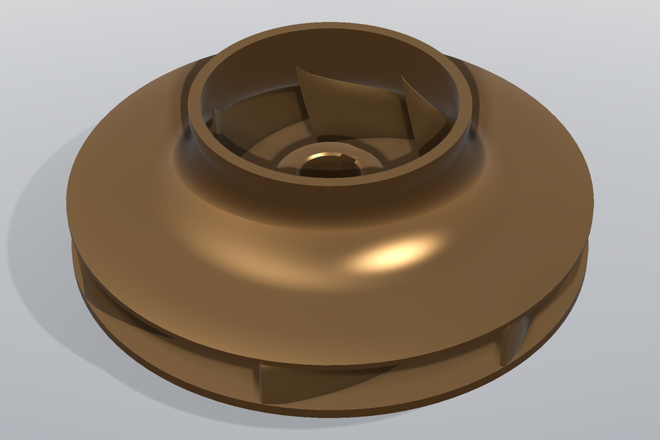

Closed (shrouded) centrifugal pump impeller of the ERCOFTAC test-case size: D2 = 420 mm, 7 backward-curved log-spiral blades between inlet angle beta1 and outlet angle beta2, hub with keyed bore, back shroud and front shroud with suction eye and wear-ring neck. Blades are separate bodies penetrating both shrouds.

- Bounding box (default build, L x W x H): 0.42 x 0.42 x 0.166 m. Frame: right-handed, metres: z the rotation axis pointing into the suction eye (upstream), origin on the axis in the hub-side plane of the outlet (back-shroud inner face); the impeller rotates in +theta about +z, blades are backward-curved.
- Parameters: `outlet_diameter` [m], `outlet_width` [m], `eye_diameter` [m], `blade_count`, `beta1_deg` [deg], `beta2_deg` [deg], `blade_thickness` [m], `bore_diameter` [m], `keyway`, `keyway_width` [m], `keyway_depth` [m], `front_shroud`.
- Physics: pump performance (head, efficiency) with frozen-rotor / sliding-mesh CFD; impeller-diffuser interaction and unsteady blade loading; cavitation at the blade leading edge; rotordynamic and structural (FEA) analysis of the impeller.
- Sources: *(estimate)* outlet diameter D2 = 420 mm and 7 blades of the ERCOFTAC centrifugal-pump test impeller (recalled from the published description; check against the paper before quantitative use): Ubaldi, M., Zunino, P., Barigozzi, G., Cattanei, A. (1996). An experimental investigation of stator induced unsteadiness on centrifugal impeller outflow. J. Turbomach. 118(1), 41-54. https://doi.org/10.1115/1.2836604 (ERCOFTAC centrifugal pump test case); *(estimate)* b2 = 40 mm, eye 200 mm, beta1 = 20 deg, beta2 = 22.5 deg, blade thickness 6 mm, shroud / hub contours, wrap angle: generic design within the usual ranges: Gulich, J.F. (2014). Centrifugal Pumps, 3rd ed. Springer. https://doi.org/10.1007/978-3-642-40114-5 (impeller design: blade angles, log-spiral blades, shroud / hub contours); keyway 14 mm wide, 3.8 mm deep in the hub for a 50 mm shaft: DIN 6885-1 (1968). Parallel keys, keyways, deep pattern (shaft 44-50 mm: key 14 x 9, hub depth 3.8 mm)


### Marine

#### KRISO Container Ship (KCS), full scale (`container_ship_kcs`)

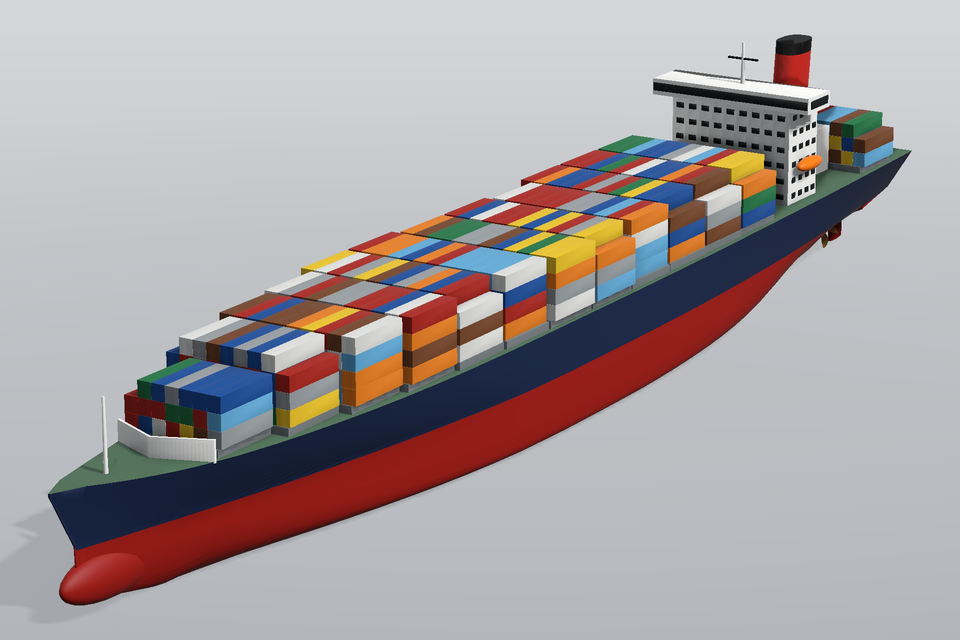

3600-TEU class container ship at full scale (Lpp 230 m, B 32.2 m, T 10.8 m, Cb ~0.65) with bulbous bow, transom stern, skeg, 5-blade propeller and rudder, aft deckhouse with bridge windows and wings, funnel, hatch covers and stacked containers. The hull form is a parametric approximation of the KCS lines (the official offsets are not reproduced); draft, trim and container tiers are parameters.

- Bounding box (default build, L x W x H): 241.1 x 32.2 x 47 m. Frame: right-handed, metres: x aft from the forward perpendicular (FP at x = 0, AP at x = 230), y to starboard, z up; z = 0 on the calm waterline (the keel at midships is at z = -draft).
- Parameters: `draft` [m], `trim` [m], `container_tiers`.
- Physics: calm-water resistance and nominal / effective wake (RANS, free surface); self-propulsion with the 5-blade propeller and rudder (SIMMAN / Tokyo 2015 cases); seakeeping and added resistance in waves; trim optimisation; wind loads on the superstructure and container stacks.
- Sources: KCS: Lpp 230 m, B 32.2 m, T 10.8 m, D 19.0 m, Cb 0.651, bulbous bow and transom stern: Kim, W.J., Van, S.H., Kim, D.H. (2001). Measurement of flows around modern commercial ship models. Experiments in Fluids 31(5), 567-578. https://doi.org/10.1007/s003480100332; KCS full-scale data and propeller (D = 7.9 m, 5 blades, P/D ~ 1.0): Hino, T., Stern, F., Larsson, L., Visonneau, M., Hirata, N., Kim, J. (eds.) (2021). Numerical Ship Hydrodynamics: An Assessment of the Tokyo 2015 Workshop. Lecture Notes in Applied and Computational Mechanics 94, Springer. https://doi.org/10.1007/978-3-030-47572-7 (KCS: Lpp 230 m, B 32.2 m, T 10.8 m, D 19.0 m, Cb 0.6505, propeller D 7.9 m, 5 blades, scale 1:31.6); KCS manoeuvring definition (rudder, propeller): SIMMAN 2008 / 2014 workshop on verification and validation of ship manoeuvring simulation methods: KCS geometry and conditions. http://www.simman2014.dk/ship-data/moeri-container-ship-kcs/; *(estimate)* hull form: super-ellipse sections on parametric waterlines tuned to Cb ~ 0.65, stem rake, forefoot, skeg and counter; the official KCS offsets are NOT reproduced: parametric approximation; *(estimate)* bulb, rudder (5.3-6.0 m chord, NACA 0018), propeller blade outline and skew, deckhouse, bridge, funnel, lifeboats, hatch covers, 13-row container stowage (40-ft ISO boxes 12.19 x 2.44 x 2.59 m), propeller centre 4.4 m above the keel: estimates for a 3600-TEU class ship (the KCS was conceived without superstructure)

#### Wigley parabolic hull (`wigley_hull`)

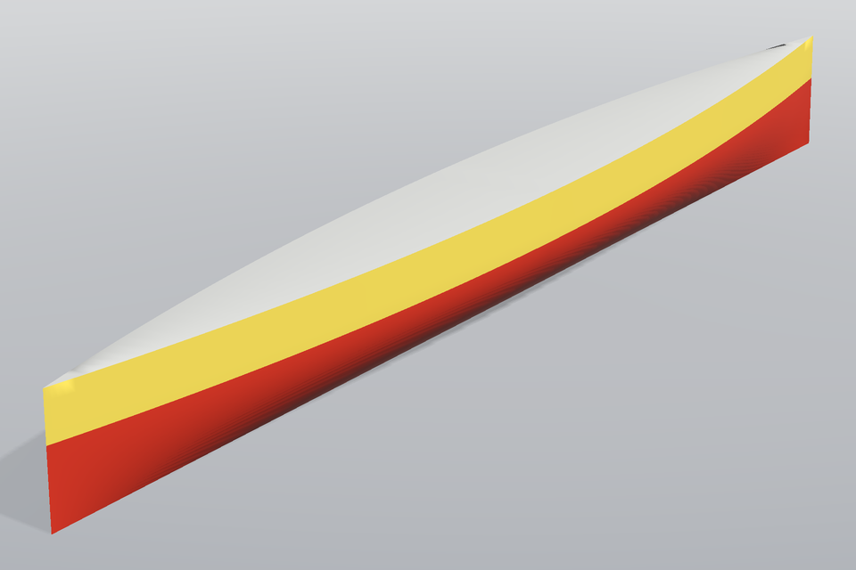

The analytic Wigley hull y = (B/2)(1 - (2x/L)^2)(1 - (z/T)^2) below the waterline, continued wall-sided up to a flat deck at the freeboard: a closed solid (Cb = 4/9). The classic ITTC benchmark for wave resistance, sinkage / trim and potential-flow / RANS free-surface codes.

- Bounding box (default build, L x W x H): 1 x 0.1 x 0.1025 m. Frame: right-handed, metres: x aft, y to starboard, z up; origin at midships on the centre plane in the calm waterline (bow at x = -L/2, stern at x = +L/2, keel at z = -T).
- Parameters: `length` [m], `beam` [m], `draft` [m], `freeboard` [m].
- Physics: wave resistance and wave pattern (Michell thin-ship theory, Rankine panels); RANS / VOF free-surface CFD validation (resistance, sinkage and trim); seakeeping: heave / pitch response in head waves; mesh-convergence benchmark for hull CFD.
- Sources: parabolic waterlines and frames y = (B/2)(1-(2x/L)^2)(1-(z/T)^2): Wigley, W.C.S. (1934). A comparison of experiment and calculated wave-profiles and wave-resistances for a form having parabolic waterlines. Proc. Royal Society of London A 144(851), 144-159. https://doi.org/10.1098/rspa.1934.0040; benchmark proportions L/B = 10, B/T = 1.6: Kajitani, H., Miyata, H., Ikehata, M., Tanaka, H., Adachi, H., Namimatsu, M., Ogiwara, S. (1983). The summary of the cooperative experiment on Wigley parabolic model in Japan. Proc. 2nd DTNSRDC Workshop on Ship Wave-Resistance Computations, Bethesda, 5-35 (ITTC Resistance Committee benchmark, L/B = 10, B/T = 1.6); *(estimate)* default L = 1 m (non-dimensional reference) and freeboard 0.04 L, wall-sided above the waterline: choice for a normalised closed solid


### Ground vehicle

#### Open-wheel racing car (Formula 1 style) (`f1_car`)

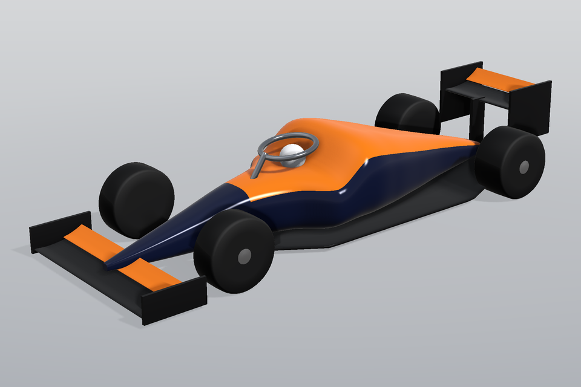

Monocoque with sidepods and engine cover, floor with diffuser, two-element front and rear wings with endplates (DRS open or closed), driver helmet, halo and four exposed wheels. In the spirit of the 2022+ regulations, not any team's car. Wraps pinneapple_design.geometry.vehicles3d.FormulaCar.

- Bounding box (default build, L x W x H): 5.57 x 1.97 x 1.03 m. Frame: right-handed, metres: x aft from the nose (the free-stream direction), y to starboard (right), z up; origin on the centre plane at the front-wing leading edge, z = 0 on the ground for ground vehicles.
- Parameters: `wheelbase` [m], `ride_height` [m], `front_wing_aoa` [deg], `front_flap_aoa` [deg], `rear_wing_aoa` [deg], `rear_flap_aoa` [deg], `drs_open`, `diffuser_angle` [deg].
- Physics: ground-effect aerodynamics (downforce, floor and diffuser); wake / dirty-air studies for following; DRS open / closed drag delta; tyre-wake interaction.
- Sources: max wheelbase 3.6 m, width 2.0 m, height 0.95 m above the reference plane, 18-inch wheels (tyre diameter ~0.72 m): FIA (2022). Formula 1 Technical Regulations, articles 3 and 10; *(estimate)* wing chords, sidepod and engine-cover shapes: estimates from broadcast imagery
- Wraps `pinneapple_design.geometry.vehicles3d.FormulaCar` (still importable from there).

#### Four-door road car (fastback / notchback) (`road_car`)

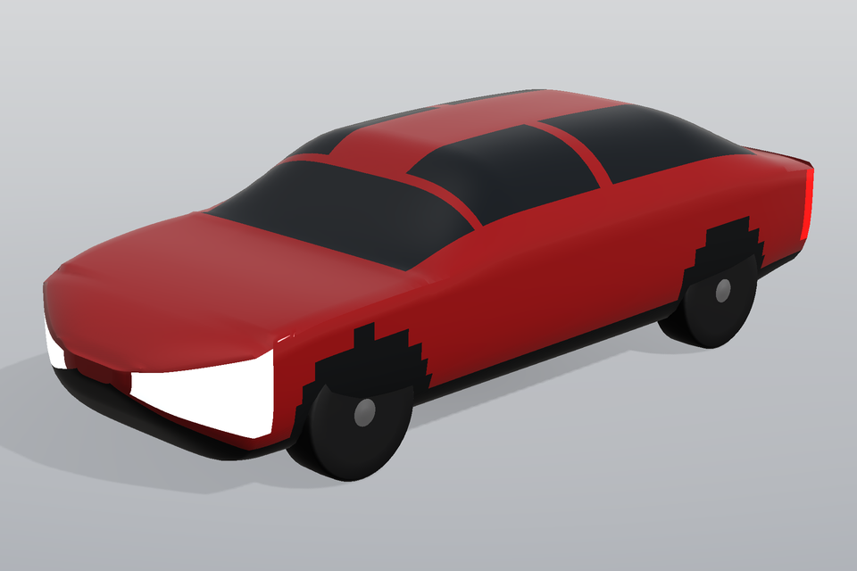

Mid-size four-door saloon: super-elliptic body with glazing, lights, trim and wheel arches, four tyres with rims, slant / rear-window angle as the main aerodynamic parameter (Ahmed-body physics on a realistic shape). Wraps pinneapple_design.geometry.vehicles3d.RoadCar.

- Bounding box (default build, L x W x H): 4.6 x 1.86 x 1.39 m. Frame: right-handed, metres: x aft from the nose (the free-stream direction), y to starboard (right), z up; origin on the centre plane at the nose, z = 0 on the ground for ground vehicles.
- Parameters: `length` [m], `width` [m], `roof_height` [m], `clearance` [m], `windshield_deg` [deg], `slant_deg` [deg], `style`, `wheelbase` [m], `wheel_radius` [m].
- Physics: external aerodynamics with moving ground (drag, lift, wake); slant-angle / rear-wake studies; aero-acoustics around the A-pillar; vehicle soiling and cooling-drag surrogates.
- Sources: *(estimate)* D-segment saloon envelope (length 4.6-4.9 m, width 1.82-1.87 m, height 1.40-1.45 m): manufacturer data of mid-size saloons; generic shape, not a specific model; slant-angle drag physics: Ahmed, S.R., Ramm, G., Faltin, G. (1984), SAE 840300
- Wraps `pinneapple_design.geometry.vehicles3d.RoadCar` (still importable from there).


### Space

#### Two-stage launcher (Falcon 9 Block 5 class) (`falcon9_booster`)

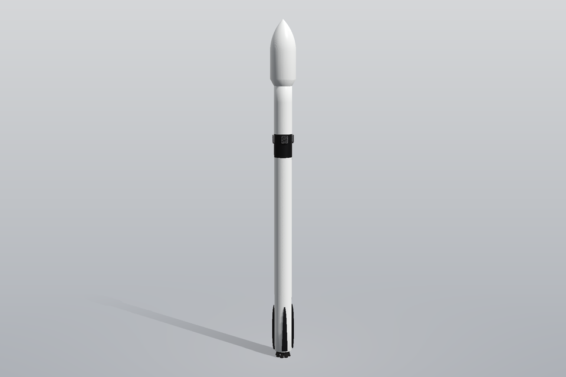

Two-stage medium-lift launcher: 3.7 m core with a white first stage, black interstage carrying four titanium lattice grid fins, white second stage and a 5.2 m x 13.1 m ogive payload fairing; nine Merlin-class bells in an octaweb and four folding carbon landing legs. Grid-fin angle, leg deployment and fairing on / off for ascent and booster-return aerodynamics.

- Bounding box (default build, L x W x H): 5.2 x 5.2 x 70 m. Frame: right-handed, metres: z up along the vehicle axis, x / y lateral; origin on the axis in the plane of the first-stage nozzle exits; legs and grid fins at 45 / 135 / 225 / 315 deg azimuth.
- Parameters: `grid_fin_angle` [deg], `legs_deployed`, `fairing`.
- Physics: ascent aerodynamics (axial force, transonic buffet on the fairing / boattail); booster re-entry and landing burn: grid-fin control authority, base heating of the octaweb; supersonic retro-propulsion plume-body interaction; structural loads: wind / max-q bending.
- Sources: height 70 m, core diameter 3.7 m, nine first-stage engines, black interstage, grid fins and four landing legs: SpaceX (2024). Falcon 9 vehicle overview (height 70 m, diameter 3.7 m, nine Merlin engines on the first stage, one Merlin Vacuum on the second). https://www.spacex.com/vehicles/falcon-9/; payload fairing outer diameter 5.2 m, height 13.1 m: SpaceX (2021). Falcon User's Guide, sections 1-3 and 5 (fairing 5.2 m outer diameter, 13.1 m height; vehicle configuration). https://www.spacex.com/media/falcon-users-guide-2021-09.pdf; *(estimate)* stage break-down (first stage to 42.6 m, interstage to 47.3 m, second stage to 56.9 m), ogive shape, bell contour (exit diameter 0.86 m), octaweb ring radius 1.2 m: estimates from published photographs and the overall dimensions; *(estimate)* grid fin 1.5 x 1.3 x 0.22 m with a 45-deg lattice, leg length 9.6 m, deployed leg angle 115 deg, leg / fin azimuths: estimates from photographs

#### Two-stage launch vehicle with fins (`launch_vehicle_two_stage`)

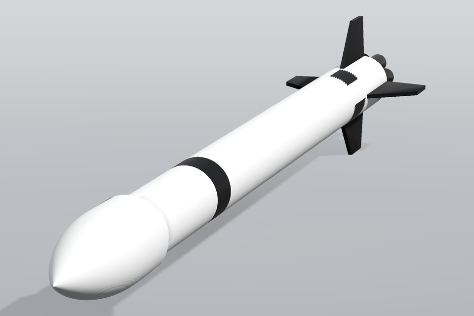

Two-stage launcher with a tangent-ogive payload fairing, interstage, four tail fins in + configuration and a cluster of engine bells (plume off). Wraps pinneapple_design.geometry.vehicles3d.LaunchVehicle (Barrowman stability included there).

- Bounding box (default build, L x W x H): 43.5 x 7.8 x 7.8 m. Frame: metres; x along the axis from the nose tip toward the engines (the free-stream direction in ascent), y and z across, fins in the x-y and x-z planes.
- Parameters: `length` [m], `diameter` [m], `fin_span` [m], `n_engines`.
- Physics: ascent aerodynamics (transonic / supersonic drag, Cp); static stability (Barrowman); fin flutter / aeroelastic surrogates.
- Sources: *(estimate)* proportions of medium-lift launchers (fineness 12-15, fairing 1.2 x core): generic; not a specific vehicle; fin aerodynamics: Barrowman, J. (1967). The practical calculation of the aerodynamic characteristics of slender finned vehicles. NASA Goddard
- Wraps `pinneapple_design.geometry.vehicles3d.LaunchVehicle` (still importable from there).

#### NASA VIPER lunar rover (`viper_rover`)

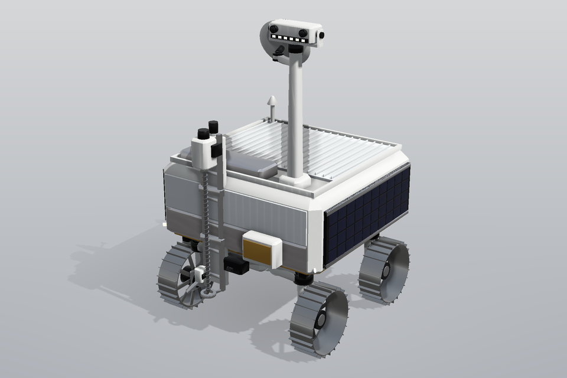

Volatiles Investigating Polar Exploration Rover from public NASA figures: chassis with side and aft solar arrays, deck radiator, mast with camera head, high- and low-gain antennas, TRIDENT drill, four active-suspension corner modules with spoked, grousered wheels. Wraps pinneapple_simulation.vehicle.viper.viper().cad.

- Bounding box (default build, L x W x H): 1.692 x 1.539 x 2.5 m. Frame: right-handed, metres: x forward, y to the left, z up; origin on the ground below the chassis centre.
- Parameters: `wheel_radius` [m], `wheel_width` [m], `grouser_count`, `grouser_height` [m].
- Physics: terramechanics (wheel-soil, slip, sinkage); multibody dynamics; thermal (lunar night, radiator); lighting / perception at the lunar south pole.
- Sources: 1.5 m x 1.5 m x 2.5 m (mast up), ~450 kg, wheels ~0.5 m diameter, active suspension: NASA VIPER fact sheets and NTRS papers listed in pinneapple_simulation.vehicle.viper.VIPER_SOURCES; *(estimate)* detail placement (antennas, hazcams, instruments): estimates from NASA imagery; bounding box of the model: 1.69 m long (the front instruments and bumpers stand proud of the 1.5 m chassis), 1.54 m wide over the wheels, 2.50 m to the top of the mast: model geometry
- Wraps `pinneapple_simulation.vehicle.viper.viper_cad` (still importable from there).


### Rotorcraft

#### Light twin helicopter (H145 class) (`helicopter_h145`)

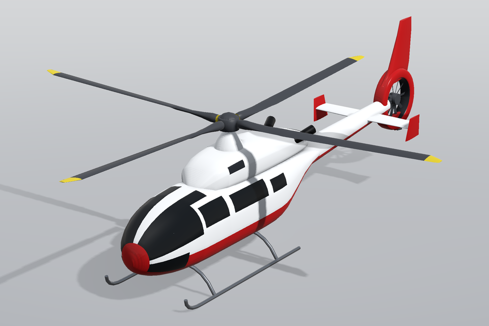

Light twin-engine helicopter: pod-and-boom fuselage with wrap-around glazing and a livery, engine cowling with exhausts, four-blade bearingless main rotor (NACA 0012/1312-type sections, -10 deg linear twist, collective, coning, azimuth), ducted Fenestron-type tail rotor with ten unevenly spaced blades in a shroud with fin and ventral fin, horizontal stabiliser with endplates and a skid landing gear; standing on the skids.

- Bounding box (default build, L x W x H): 13.64 x 11 x 3.95 m. Frame: right-handed, metres: x aft from the nose (the free-stream direction), y to starboard (right), z up; origin on the centre plane at the nose, z = 0 on the ground under the skids; length includes the main rotor turning (blade 1 over the nose at azimuth 0).
- Parameters: `rotor_diameter` [m], `collective_deg` [deg], `rotor_azimuth_deg` [deg], `coning_deg` [deg].
- Physics: rotor aerodynamics in hover and forward flight (BEM, actuator disc, blade-resolved CFD); rotor-fuselage interaction and download on the stabiliser; ducted tail-rotor (Fenestron) performance and acoustics; brown-out / downwash near the ground; ground resonance on skids.
- Sources: main-rotor diameter 11.00 m, length rotors turning 13.64 m, fuselage length 11.64 m, height 3.95 m: Airbus Helicopters (2023). H145 technical data / H145 Technical Information brochure: main rotor diameter 11.00 m, length (rotors turning) 13.64 m, fuselage length 11.64 m, height 3.95 m. https://www.airbus.com/en/products-services/helicopters/civil-helicopters/h145; four-blade bearingless main rotor, Fenestron tail rotor: EASA (2023). Type-Certificate Data Sheet R.010 (MBB-BK 117 / H145): four-blade bearingless main rotor, ducted (Fenestron) tail rotor on the D-3 / H145 variants; *(estimate)* blade chord 0.31 m, -10 deg twist, NACA 0012/1312 stand-ins (the actual DM-H3/H4 sections are not reproduced), Fenestron ~1.1 m duct with 10 blades, rotor-hub height 3.28 m, cabin width 1.74 m, skid track 2.2 m, stabiliser span 2.76 m: estimates from photographs and three-views


### Rail

#### High-speed train (ICE 3 / CRH3 class) (`high_speed_train`)

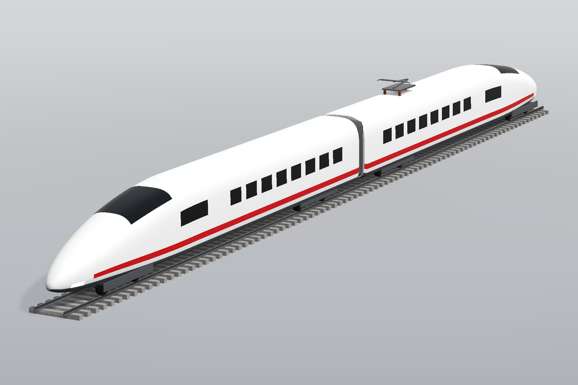

Streamlined head car with a long nose, wrap-around windscreen and headlights, passenger window band and red livery stripe, bogies with 920 mm wheelsets behind fairings, gangway in the inter-car gap, a lowered pantograph on the roof and a trailing end car, on two rails and sleepers (top of rail z = 0). Nose length and number of cars (1-3) as parameters, zero yaw.

- Bounding box (default build, L x W x H): 51.95 x 2.95 x 5.07 m. Frame: right-handed, metres: x aft from the nose (the free-stream direction), y to starboard (right), z up; origin on the centre plane at the nose, z = 0 at the top of rail (EN 14067 reference plane); rails and sleepers lie below z = 0.
- Parameters: `nose_length` [m], `n_cars`.
- Physics: train aerodynamics: drag, slipstream and the nose pressure pulse (EN 14067); crosswind stability (side force and roll moment; yaw by rotating the inflow); tunnel entry micro-pressure waves and passing-train loads; pantograph aero-acoustics and under-body / ballast flow.
- Sources: car width 2.95 m, height 3.89 m above top of rail, end car 25.675 m, intermediate car 24.775 m, bogie-centre distance 17.375 m, wheel diameter 0.92 m: Siemens Mobility (2018). Velaro D / ICE 3 (BR 407) and Velaro China (CRH3) technical data: car body width 2,950 mm, height above top of rail 3,890 mm, end-car length 25,675 mm, intermediate-car length 24,775 mm, bogie-centre distance 17,375 mm, wheel diameter 920 mm (new). Velaro product data sheets, https://www.mobility.siemens.com/global/en/portfolio/rail/rolling-stock/high-speed-and-intercity-trains/velaro.html; top of rail as the aerodynamic reference plane, standard gauge 1.435 m: CEN (2018). EN 14067-4: Railway applications - Aerodynamics - Part 4: Requirements and test procedures for aerodynamics on open track (top of rail as the reference plane, standard gauge 1435 mm); rail profile (60E1-like, 172 mm high, 72 mm head, 150 mm foot): CEN (2017). EN 13674-1: Railway applications - Track - Rail - Vignole railway rails 46 kg/m and above (60E1); *(estimate)* nose profile and plan-form curves, windscreen extent, window pitch 1.45 m, inter-car gap 0.6 m, bogie wheelbase 2.5 m, pantograph geometry, sleeper 2.6 x 0.26 x 0.22 m at 0.6 m: estimates from photographs of ICE 3 / CRH3 trains


### Thermal

#### Pin-fin heat sink (`pin_fin_heatsink`)

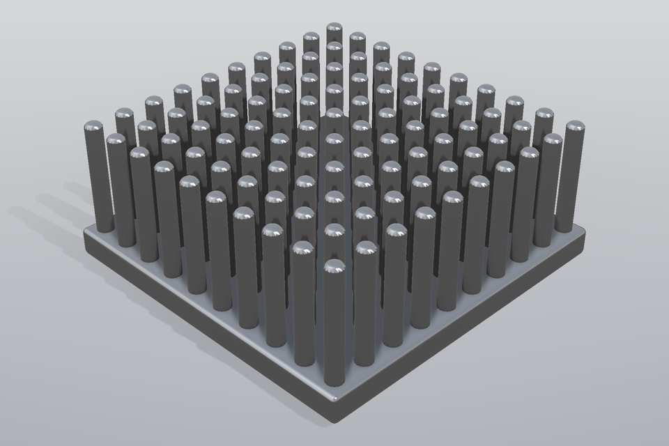

Electronics pin-fin heat sink: a 60 x 60 x 5 mm aluminium base plate carrying an in-line (or staggered) array of circular, square or elliptic pin fins set by diameter, height and pitch, with a copper heat-source pad under the base. Flow along x for forced-convection studies.

- Bounding box (default build, L x W x H): 0.06 x 0.06 x 0.0265 m. Frame: right-handed, metres: x along the base length (cooling-air flow direction), y across, z up along the pins; origin at the centre of the base plate's underside (the heat-source pad lies below, z < 0).
- Parameters: `base_length` [m], `base_width` [m], `base_thickness` [m], `pin_diameter` [m], `pin_height` [m], `pitch` [m], `pin_shape`, `pin_aspect`, `layout`, `heat_source`, `source_size` [m], `source_thickness` [m].
- Physics: conjugate heat transfer (pins + base, heat source); forced convection and pressure drop across pin arrays (inline vs staggered); flow bypass and fin-efficiency studies; thermal design optimisation (pin diameter / pitch / height).
- Sources: pin-fin heat-sink family and test configuration (square base with in-line pin arrays, bypass flow, pin diameter / height / pitch as the design variables): Jonsson, H., Moshfegh, B. (2001). Modeling of the thermal and hydraulic performance of plate fin, strip fin, and pin fin heat sinks - influence of flow bypass. IEEE Trans. Compon. Packag. Technol. 24(2), 142-149. https://doi.org/10.1109/6144.926376; in-line versus staggered pin-fin array arrangement: Sparrow, E.M., Ramsey, J.W., Altemani, C.A.C. (1980). Experiments on in-line pin fin arrays and performance comparisons with staggered arrays. J. Heat Transfer 102(1), 44-50. https://doi.org/10.1115/1.3244247; *(estimate)* base 60 x 60 x 5 mm, pins d = 3 mm, h = 20 mm, pitch 6 mm (10 x 10), 25 mm heat-source pad: representative of the tested heat sinks, not the exact published specimens: engineering estimate


### Energy

#### NREL 5-MW reference wind turbine (`wind_turbine_nrel5mw`)

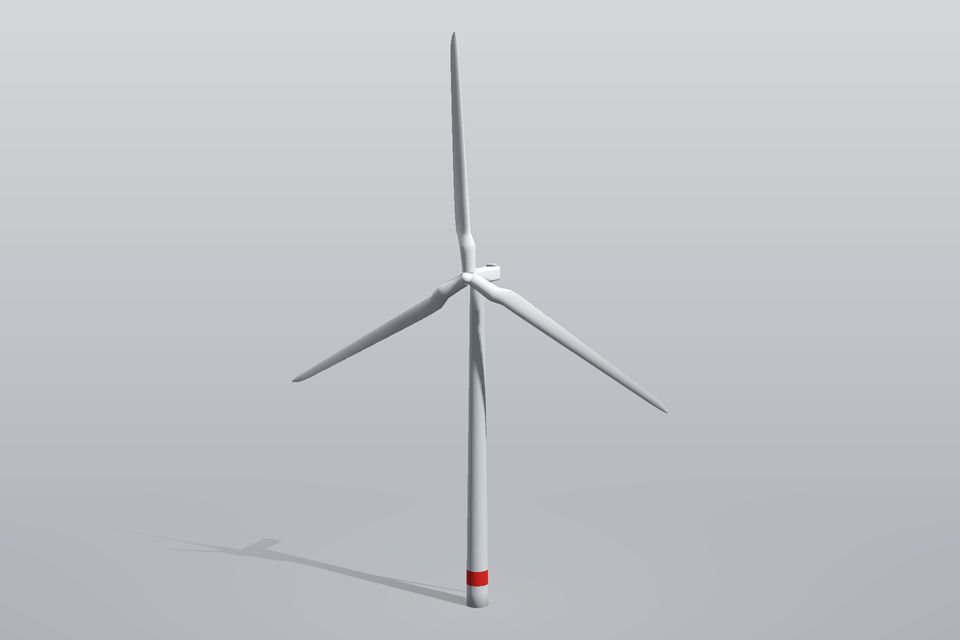

Three-bladed upwind 5-MW turbine: blades lofted through the published chord / twist table with a cylinder-to-airfoil root transition, 2.5 deg precone, 5 deg shaft tilt, hub with spinner, nacelle and tapered tower (onshore, base at z = 0). Rotor azimuth, blade pitch and yaw-free geometry for rotor CFD (actuator line / sliding mesh), wake and loads studies.

- Bounding box (default build, L x W x H): 24.49 x 109.3 x 152.5 m. Frame: right-handed, metres: x downwind, y lateral, z up; origin at the tower base on the ground; rotor upwind of the tower (x < 0).
- Parameters: `rotor_diameter` [m], `hub_diameter` [m], `hub_height` [m], `pitch_deg` [deg], `rotor_azimuth_deg` [deg], `precone_deg` [deg], `shaft_tilt_deg` [deg], `overhang` [m], `nacelle_length` [m].
- Physics: rotor aerodynamics (BEM, actuator line, blade-resolved CFD); wake and wind-farm interaction; aeroelastic blade loads; tower shadow, icing, erosion of the leading edge.
- Sources: rotor 126 m, hub 3 m, hub height 90 m, precone 2.5 deg, shaft tilt 5 deg, overhang 5 m, blade chord / twist / airfoil table, tower 6 m -> 3.87 m over 87.6 m: Jonkman, J., Butterfield, S., Musial, W., Scott, G. (2009). Definition of a 5-MW Reference Wind Turbine for Offshore System Development. NREL/TP-500-38060. https://doi.org/10.2172/947422; *(estimate)* airfoil shapes: the DU 40/35/30/25/21 and NACA 64-618 sections are approximated by NACA 4-digit sections with the same thickness ratio and 2-4 % camber: approximation (coordinates of the DU sections are not reproduced); bounding box: 109.3 m wide because at azimuth 0 the blades point up and at +-120 deg (2 R sin 120 deg), 152.5 m high (hub 90 m + R cos(precone)): model geometry; *(estimate)* nacelle 14 x 3.8 x 3.9 m and spinner shape: estimates from 5-MW-class nacelles

