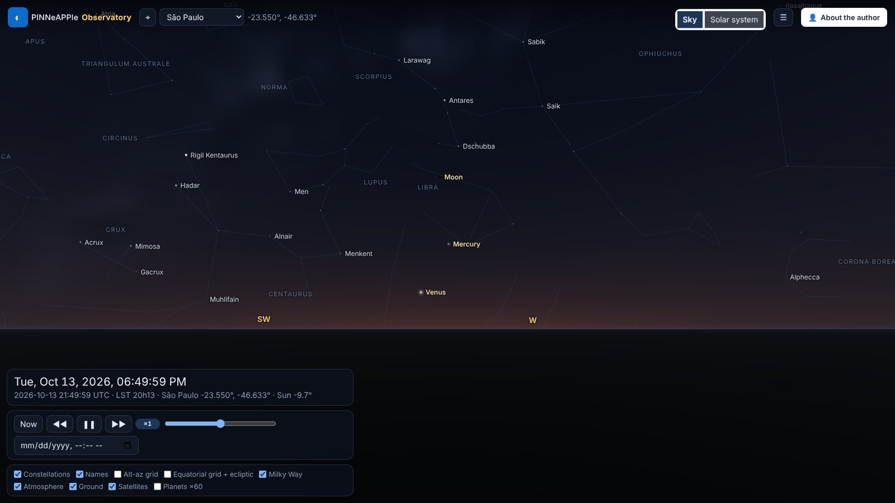
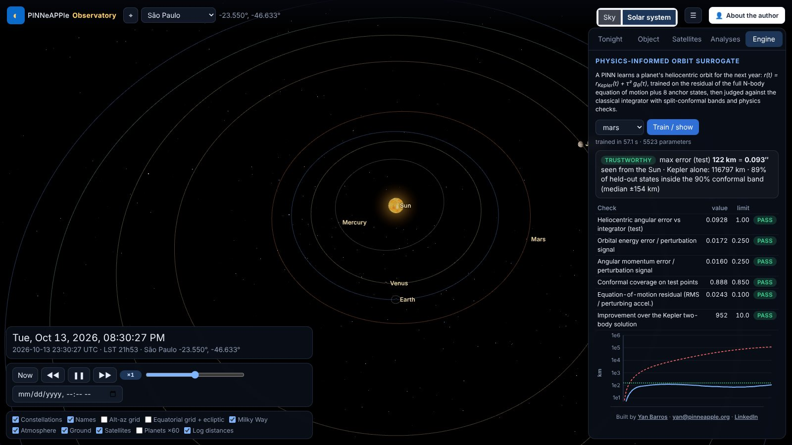

# The PINNeAPPle Observatory

A 3-D web app that shows the sky and the solar system as they are now from the visitor's location, with satellites,
astrophysics analyses and a physics-informed orbit surrogate shown with its trust checks.



## Run it

```bash
pip install -e ".[sky]" -r apps/observatory/requirements.txt
cd apps/observatory && uvicorn observatory.api:app --port 8094
```

Open `http://localhost:8094`, press ⌖ (or pick a city). Drag to look around, scroll or pinch to zoom, click an object.
*Solar system* flies out from your position to the planets; *Sky* flies back. URL parameters make views reproducible:
`?lat=-23.55&lon=-46.63&t=2026-10-13T22:05:00Z&az=250&alt=16&fov=72` (`view=system`, `tab=engine`, `panel=0`).

## What is computed where

The server (`apps/observatory/observatory/api.py`) calls `pinneapple_physics.astro` for every position, event and
analysis and returns samples a few minutes apart; the browser interpolates them, rotates the J2000 star catalogue with
the server's precession-nutation matrix and the sidereal time, and draws (three.js r169, vendored with the library).
Refraction and extinction of the stars are applied in the vertex shader with the same formulas as the library.

## Checking it

`pytest tests/test_astro_accuracy.py tests/test_observatory.py` runs the accuracy checks
([table](../core_concepts/astro.md#accuracy)) and every API endpoint offline (a local TLE file stands in for CelesTrak).


